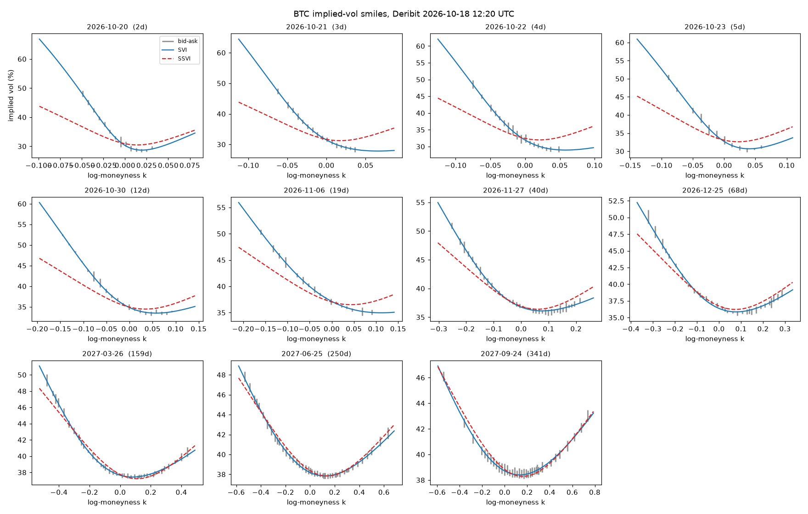
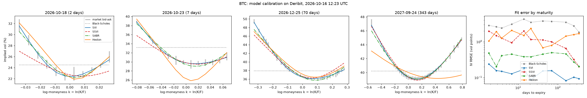

# Options Model Validation Lab

An independent validation of option-pricing models on live market data. It answers the question a model-validation
team asks: does the model fit the market, is it free of arbitrage, and does it hedge well?

Data: free public Deribit option chains for BTC and ETH, with no API key. One snapshot is about 900 listed options
across 11 expiries.

## Status

- [x] **Step 1: implied-vol surface.** Black-76 implied vols from bid, ask and mark prices. Raw SVI is fitted per
  expiry using the quasi-explicit method (Zeliade 2009), with Lee's moment bound and a Durrleman butterfly-arbitrage
  check. SSVI (Gatheral & Jacquier 2014) is fitted as a globally arbitrage-free benchmark, and calendar arbitrage is
  checked across expiries.
- [x] **Step 2: model calibration.** Black-Scholes, SABR and Heston are calibrated to the same chains as SVI and SSVI.
  Heston is priced with the COS method, which matches the published Fang & Oosterlee reference price to 1e-6. Each
  calibration is checked on synthetic data, where it must recover the known parameters, and with a bootstrap that
  redraws every quote inside its bid-ask spread. Parameters are saved for every snapshot, so their stability over
  time builds up day by day.
- [ ] Step 3: delta-hedging backtest on daily snapshots, to see which model hedges best.
- [ ] Step 4: an automatically generated model-validation report, plus a live dashboard.

## First results (BTC, 16 Oct 2026)

| | SVI per expiry | SSVI (global) |
|---|---|---|
| IV error (RMSE, vol points) | 0.09 to 0.25 | 0.22 to 2.26 |
| Fitted IV inside the bid-ask spread | 92 to 100% | 20 to 85% |
| Butterfly / calendar arbitrage | none found | none, by construction |

SSVI is arbitrage-free by construction, but its single skew parameter misses the steep short-dated BTC put skew by
1 to 2 vol points. That trade-off between flexibility and guaranteed no-arbitrage is the central question of the
validation.



## Model comparison (BTC, 16 Oct 2026, 284 quotes, 2 to 343 days)

| Model | Parameters | Median IV error (vol points) | Quotes priced inside bid-ask |
|---|---|---|---|
| Black-Scholes | 1 per expiry | 3.07 | 11% |
| SVI | 5 per expiry | 0.15 | 100% |
| SABR (beta = 1) | 3 per expiry | 0.41 | 79% |
| SSVI | 3 global + ATM curve | 1.12 | 53% |
| Heston | 5 global | 1.50 | 23% |



**Validation findings**

1. **Heston needs implausible dynamics and still misses.** The best fit has mean reversion kappa = 57 (variance
   half-life of about 4.5 days) and vol-of-vol xi = 8.6 (865%), with a Feller ratio of 0.26. Even so, it misprices
   7-day at-the-money options by about 3.5 vol points and leaves 1.5 vol points of error at both ends of the term
   structure. With kappa capped at 30 the fit only moves error from short to long maturities.
2. **Stable is not the same as correct.** Redrawing every quote inside its bid-ask spread moves the Heston parameters
   by only 1 to 2% (30 refits). The data pins them down tightly, so the misfit is model risk, not estimation noise.
   Pure diffusion cannot produce steep short-dated crypto smiles; that calls for jumps (Bates) or a per-expiry
   model.
3. **SABR is the practical choice per expiry.** Three parameters fit within the spread for 79% of quotes. Its
   vol-of-vol nu falls with maturity roughly like 1/sqrt(T) (nu * sqrt(T) is about 0.6 to 0.76 from 2 to 343 days).
   Only the correlation rho of the 2 to 3 day expiries is poorly identified (10 to 12% variation in the bootstrap).
4. **SVI is the best marking tool, but not a dynamic model.** It fits every quote inside the spread, but it describes
   one day's smile and says nothing about how the smile moves. Step 3's hedging test decides which model is actually
   useful for risk.

## Data choices

- Only out-of-the-money options with a two-sided market are fitted, and only those with |delta| of at least 5%.
  Deep-wing quotes trade at a few ticks, so their implied vols are mostly rounding noise.
- Fit weights are 1/(bid-ask spread in IV)², so tight markets count more.
- The SVI width parameter has a floor of a quarter of one at-the-money standard deviation. Without it, the
  short-dated fits collapse into a V shape that only fits quote noise.

## Run

```bash
pip install -r requirements.txt
python scripts/build_surface.py BTC      # snapshot, fit, arbitrage checks, reports/BTC_smiles.png
python scripts/calibrate_models.py BTC   # BS / SVI / SSVI / SABR / Heston on the latest snapshot
pytest -q
```

Each run saves a gzipped snapshot in `data/snapshots/`. A GitHub Actions job (`.github/workflows/snapshot.yml`)
saves BTC and ETH snapshots every day at 08:00 UTC, refits the surface and recalibrates all models
(`reports/params/`). This builds the history for the hedging
backtest.
